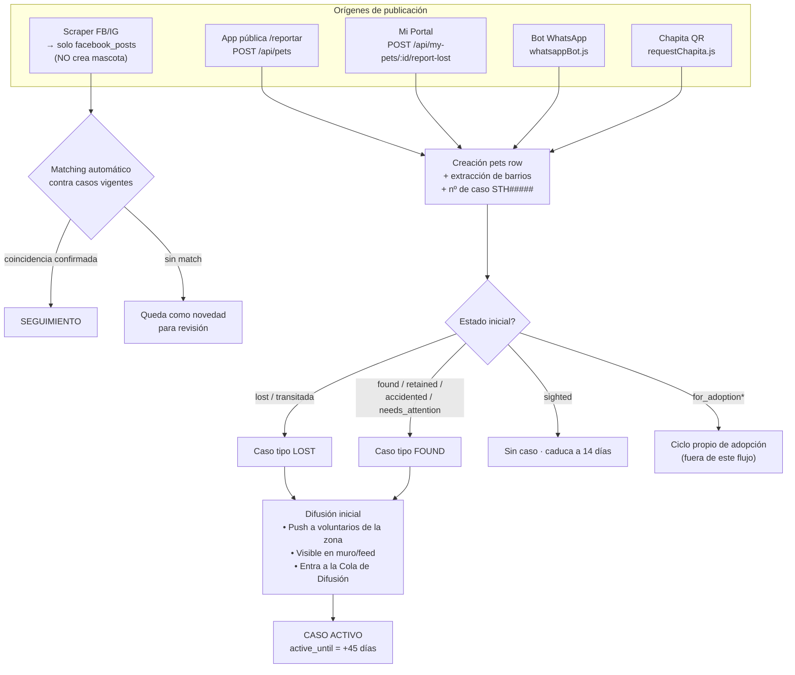
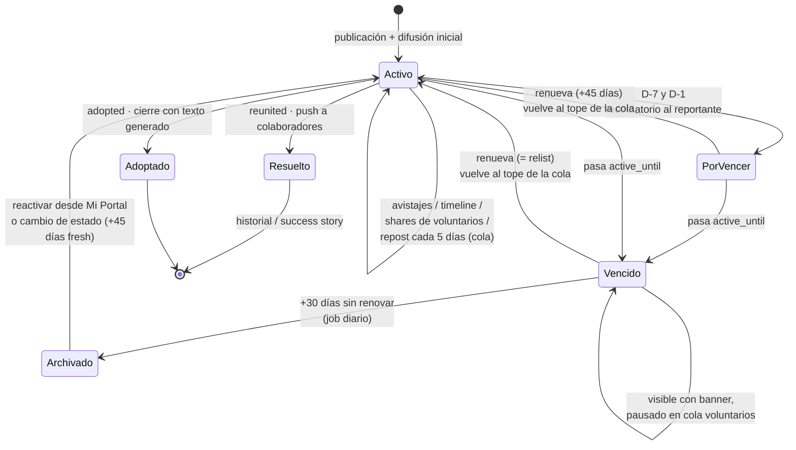

# Ciclo de vida completo del caso

Este documento describe el recorrido completo de una publicación en Sigo Tu Huella: desde que se reporta una mascota, pasando por su difusión con voluntarios y mantenimiento, hasta su resolución o vencimiento.

---

## 1. Flujo completo

## 2. Máquina de estados del caso

## 3. Orígenes de publicación

| Origen | Endpoint / código | Qué dispara |
|---|---|---|
| App pública (`/reportar`) | `POST /api/pets` | Mascota + barrios elegidos + caso |
| Mi Portal (dueño) | `POST /api/my-pets/:id/report-lost` | Caso sobre mascota registrada; extrae barrios de `location` con `extractNeighborhoods()` |
| Bot WhatsApp | `server/services/whatsappBot.js` | Mascota + caso + `extractNeighborhoods()` |
| Chapita QR | `server/routes/requestChapita.js` | Reporte sobre mascota ya registrada |
| Scraper FB/IG | webhook `/api/facebook/webhook` | Guarda en `facebook_posts`; el matching (`geminiMatching.js`) lo cruza **solo contra casos vigentes** |

## 4. Estados y qué le aplica a cada uno

| Estado | ¿Genera caso? | Ciclo 45+30d | Prioridad en cola | Notas |
|---|---|---|---|---|
| `lost` | Sí (tipo *lost*) | Sí | Normal | Caso central |
| `transitada` | Sí (tipo *lost*) | Sí | Normal | Buscar dueño sigue siendo la meta |
| `found` | Sí (tipo *found*) | Sí | Normal | Decae rápido igual que perdida |
| `retained` | Sí (tipo *found*) | Sí | Normal | Alguien la custodia temporalmente |
| `needs_attention` | Sí (tipo *found*) | Sí | **Tope** | Requiere acción urgente |
| `accidented` | Sí (tipo *found*) | Sí | **Tope** | Urgencia máxima mientras activa |
| `sighted` | No | Vigencia propia **14 días** | — | Señal efímera; filtro por fecha en queries |
| `for_adoption` / `for_adoption_simple` | No | Fuera | — | Ciclo propio de adopciones |
| `adopted` / `reunited` | Cierra el caso | Terminal | — | Quedan como historial |
| *(nuevo)* caso `archived` | — | Terminal-reactivable | — | Solo visible para el dueño; reactivable |

## 5. El ciclo fase por fase

### Creación
- Se inserta la mascota y se genera el número de caso secuencial `STH#####`.
- Los barrios se toman de la selección del usuario o se extraen del texto libre con `extractNeighborhoods()` (`server/services/geocoding.js`).
- `createPetCase()` crea la fila en `pet_cases` con `active_until = NOW() + 45 días`.

### Difusión inicial (100% voluntario-céntrica)
- Push/in-app a voluntarios suscriptos a agrupaciones cuyos barrios cubren la zona (**matching tolerante** a acentos/mayúsculas, ver §9).
- La mascota aparece en el dashboard de voluntarios y en la **Cola de Difusión**, bucket "Nuevos".
- Es visible en el muro público y ficha.

### Seguimiento
- Avistajes (`case_sightings`), timeline de eventos (`case_events`), seguidores (`case_followers`).
- Cada share manual de un voluntario registra `share_logs` + evento `social_shared`, lo que alimenta los buckets de la cola.
- El scraper cruza novedades nuevas contra casos abiertos **vigentes** (vencidos/archivados quedan excluidos).

### Mantenimiento: Cola de Difusión
Endpoint `GET /api/volunteers/diffusion-queue`. Devuelve 4 buckets calculados por voluntario:

| Bucket | Criterio |
|---|---|
| **Nuevos** | Nunca compartida por ese voluntario |
| **Repostear** | Último share propio hace más de 5 días |
| **Al día** | Último share hace ≤ 5 días |
| **Pausados** | Caso activo pero vencido (esperando renovación del reportante) |

- Solo entran los 6 estados con caso; orden interno: `accidented`/`needs_attention` primero, luego más recientes.
- Filtro por barrios suscriptos del voluntario (match tolerante).

### Recordatorios y vencimiento (job diario)
`runLifecycleCycle()` en `server/services/lifecycleJob.js` corre cada 24 h:

| Momento | Acción |
|---|---|
| D-7 (ventana 6–8 días restantes) | Push + notificación in-app al reportante |
| D-1 (ventana 0–2 días) | Push + in-app |
| Vencida +3 días | Último aviso |
| Vencida +30 días | Auto-archive del caso (evento `case_archived`) |

Cada milestone se envía **una sola vez** (dedupe por `notifications.data->>'case_id'` + `milestone`).

Mientras está vencido (activo expirado):
- La publicación **sigue visible** en muro/ficha con badge/banner "Publicación vencida".
- En la cola de voluntarios pasa al bucket **Pausados** (no quema tiempo de difusión en casos sin dueño activo).

### Renovación = relist
- `POST /api/cases/:id/renew` → `renewCase()`: extiende `active_until` +45 días y registra `case_renewed`.
- El caso vuelve al tope de la cola de difusión (su última actividad es ahora; los buckets se recalculan).
- Si el caso estaba `archived`, la renovación lo **reactiva**: status → `active` con vigencia fresca y evento `case_reactivated`.

### Archivado
- Estado nuevo de `pet_cases.status`: `archived`.
- Fuera de muro, cola, matching y notificaciones; visible solo para el dueño (banner en PetDetail).
- Reactivable desde PetDetail/Mi Portal ("Reactivar publicación") o automáticamente si cambia el estado de la mascota (`syncCaseStatus` re-abre con +45 días).

### Resolución
- `reunited`: cierra el caso (evento `case_closed` reason `reunited`), push "¡Volvió a casa!" a colaboradores y seguidores, celebración en redes.
- `adopted`: cierre con texto generado (`generateAdoptionClosureText`), queda como historial/success story.

## 6. Matriz de notificaciones

| Evento | Dueño/Reportante | Voluntarios zona | Colaboradores/seguidores |
|---|---|---|---|
| Nueva mascota en tu barrio | — | Push + in-app | — |
| Avistaje nuevo | In-app | — | In-app |
| D-7 / D-1 por vencer | Push + in-app | — | — |
| Vencida (+3 días, último aviso) | Push + in-app | — | — |
| Renovó | Confirmación | Caso vuelve arriba en cola | — |
| ¡Volvió a casa! / Adoptada | Push | — | Push celebración |

## 7. Matriz de visibilidad por actor × estado

| Estado | Público (muro/ficha) | Voluntarios (cola/dashboard) | Dueño | Admin |
|---|---|---|---|---|
| Activo vigente | ✅ | ✅ según bucket | ✅ | ✅ |
| Activo vencido | ✅ con badge/banner | ⏸ bucket Pausados | ✅ + avisos | ✅ |
| Archived | ❌ fuera del listado* | ❌ | ✅ banner + reactivar | ✅ |
| Closed (reunited/adopted) | Historial | ❌ | ✅ | ✅ |

\* La ficha directa puede seguir accesible por URL, pero sale de todos los listados y mecanismos de difusión.

## 8. Reglas transversales

1. **Ciclo uniforme**: los 6 estados con caso comparten exactamente el mismo tratamiento (45 días + recordatorios + 30 días de gracia). La única diferencia es la prioridad en la cola.
2. **Avistajes efímeros**: `sighted` no tiene caso ni renovación; deja de listarse a los 14 días de creado (filtro en queries).
3. **Adopciones fuera**: `for_adoption` / `for_adoption_simple` tienen su propio ciclo (assignments/rifas) y nunca entran a este sistema.
4. **Matching tolerante de barrios**: todas las comparaciones mascota ↔ agrupación ↔ suscripción usan normalización lowercase + trim + guiones/guiones bajos → espacios (ids del frontend `villa_elisa` == extracción server `villa elisa`) + sin acentos + aliases entre catálogos (`altos san lorenzo` == `altos de san lorenzo`, `arturo segui` == `segui`, `olmos` == `lisandro olmos`). Implementado en `neighborhoodUtils.js` con la misma cadena de reemplazos en JS y SQL.
5. **Matching del scraper solo contra casos vigentes**: una novedad de FB/IG nunca sugiere matches contra casos vencidos o archivados.
6. **Sin difusión automática externa**: la re-difusión depende exclusivamente de voluntarios; renovar = volver arriba en la cola.

## 9. Referencia técnica

| Pieza | Ubicación |
|---|---|
| Constantes 45/30 días | `CASE_ACTIVE_DAYS` / `ARCHIVE_AFTER_DAYS` en `server/services/caseService.js` |
| Mapeo estado→caso | `petCaseMapping()` en `caseService.js` |
| Sync al cambiar status (incluye re-apertura de archived) | `syncCaseStatus()` en `caseService.js` |
| Renovación/reactivación | `renewCase()` + ruta `POST /api/cases/:id/renew` |
| Cálculo on-read de vigencia | `computeExpiry()` / `withExpiry()` en `caseService.js` |
| Job diario (recordatorios + auto-archive) | `runLifecycleCycle()` en `server/services/lifecycleJob.js`, cableado en `server/index.js` |
| Cola de difusión | `GET /api/volunteers/diffusion-queue` en `server/routes/volunteers.js` |
| Vigencia en action-center | `GET /api/volunteers/pet-action-center/:petId` (campos `expired`, `days_left`, `case_status`) |
| Vigencia en ficha pública | `GET /api/pets/:id` (mismos campos) + banner en `src/pages/PetDetail.tsx` |
| Chip en muro | `case_vigencia` por fila en `GET /api/pets` + `src/components/PetCard.tsx` |
| Avisos al dueño | `lost_case_vigencia` en `GET /api/my-pets` + banner en `src/pages/MiPortal.tsx` |
| Matching tolerante | `normalizeNb()` / `nbNormSql()` / `nbOverlapSql()` en `server/services/neighborhoodUtils.js` |
| Tablas clave | `pets`, `pet_cases` (status: active/archived/closed), `share_logs`, `case_events`, `notifications`, `volunteer_subscriptions`, `agrupaciones` |
| Backfill de barrios | `POST /api/pets/admin/backfill-neighborhoods` (admin) · script `server/scripts/backfillNeighborhoods.js [--dry]` |

## 10. Glosario

- **Caso (STH#####)**: unidad de trabajo detrás de cada mascota perdida/rescatada; tiene tipo (*lost*/*found*), estado (*active*/*archived*/*closed*) y vigencia (`active_until`).
- **Tránsito (`transitada`)**: hogares temporarios que custodian a la mascota mientras se busca al dueño; recurso limitado, por eso el caso sigue siendo de búsqueda.
- **Retenida (`retained`)**: particular que custodia temporalmente a la mascota rescatada.
- **Avistaje (`sighted`)**: señal de avistamiento efímera, sin caso propio; caduca sola a los 14 días.
- **Cola de difusión**: lista priorizada por voluntario con las mascotas de su zona que necesitan shares, agrupadas en Nuevos / Repostear / Al día / Pausados.
- **Renovar (relist)**: extender la vigencia 45 días; devuelve el caso al tope de la cola. Si estaba archivado, lo reactiva.
- **Archivado**: estado terminal-reactivable de un caso vencido hace más de 30 días sin renovación.
